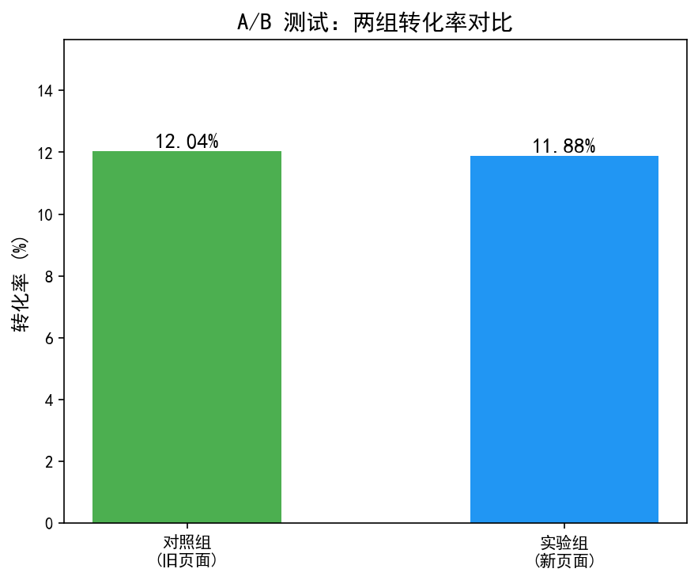
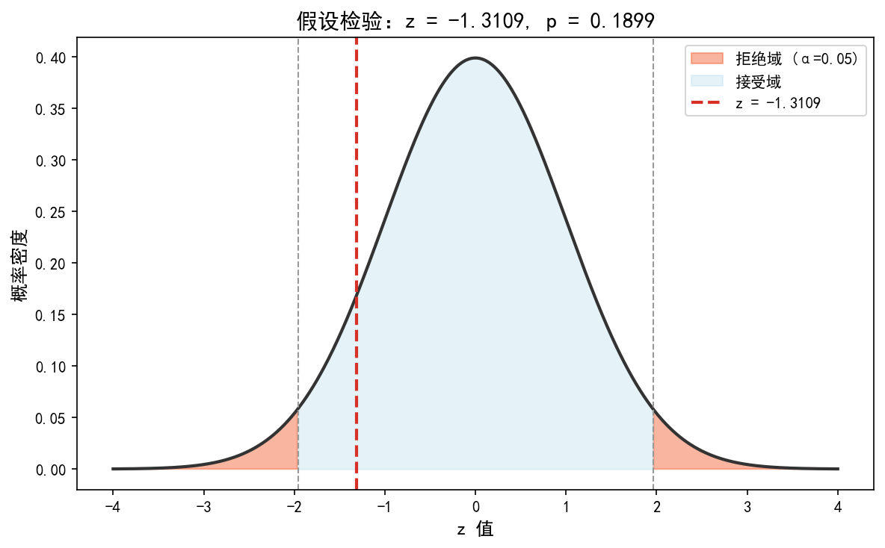

# A/B 测试分析：新页面 vs 旧页面

基于 Kaggle 公开 A/B 测试数据集，检验新落地页是否显著提升转化率。

## 数据集

| 表名 | 行数 | 说明 |
|------|------|------|
| ab_data | 294,478 | A/B 测试用户行为记录 |

字段：
- `user_id`：用户 ID
- `timestamp`：访问时间
- `group`：control（对照组/旧页面）/ treatment（实验组/新页面）
- `landing_page`：old_page / new_page
- `converted`：是否转化（0=未转化，1=转化）

数据来源：[Kaggle - A/B testing](https://www.kaggle.com/datasets/zhangluyuan/ab-testing)

## 分析流程

1. **数据清洗** — 删除 group 与 landing_page 不匹配的行，删除重复用户
2. **描述统计** — 两组转化率对比
3. **假设检验** — 双比例 z 检验，判断新页面是否显著优于旧页面
4. **置信区间** — 转化率差异的 95% 置信区间
5. **效应量** — Cohen's h 衡量差异大小
6. **样本量计算** — 检测 1% 提升所需样本量

## 关键结果

### 转化率对比

| 组别 | 用户数 | 转化数 | 转化率 |
|------|--------|--------|--------|
| 对照组（旧页面） | 145,274 | 17,489 | 12.04% |
| 实验组（新页面） | 145,310 | 17,264 | 11.88% |
| **差异** | — | — | **-0.16%** |

### 统计检验结果

| 指标 | 值 | 说明 |
|------|-----|------|
| z 统计量 | -1.3109 | — |
| p 值 | 0.1899 | > 0.05，不显著 |
| 95% 置信区间 | [-0.39%, 0.08%] | 包含 0 |
| Cohen's h | -0.0049 | 微小效应 |

### 结论

**新页面未显著提升转化率，不建议上线。**

- 统计上：p=0.1899 > 0.05，置信区间包含 0，无法证明新页面有效果
- 效应量：Cohen's h = 0.005，即使有差异也小到没有实际意义
- 样本量：每组约 14.5 万用户，远超检测 1% 提升所需的 9,979 人，结论可靠

## 图表展示

### 转化率对比



### z 检验可视化



## 项目结构

```
ab-testing-analysis/
├── data/raw/                  # 原始数据（不提交）
├── src/
│   ├── ab_analysis.ipynb      # Jupyter notebook（完整分析）
│   ├── ab_analysis.py          # 模块化代码
│   └── images/                 # 图表
├── requirements.txt
├── .gitignore
└── README.md
```

## 如何运行

```bash
# 安装依赖
pip install -r requirements.txt

# 运行模块化代码
cd src
python ab_analysis.py

# 或在 Jupyter 中运行
jupyter notebook src/ab_analysis.ipynb
```

## 技术栈

- Python 3.11
- pandas — 数据处理
- scipy — 假设检验、统计计算
- matplotlib — 可视化
